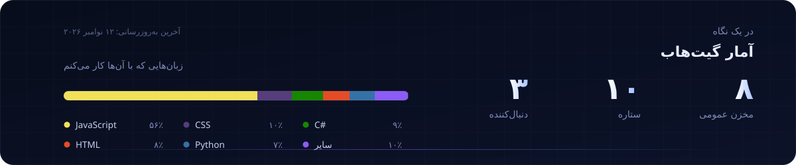

  

## Hey

I write C# for a living, break things in Python for fun, and self-host almost everything
I use. If a tool I need doesn't exist, I build a worse version of it first and fix it later.

A few things I keep poking at:

- **[Sepehr Meeting](https://github.com/sepehrsdq/Sepehr-Meeting)** — self-hosted video calls that actually work in Persian, all RTL, no external service.
- **[university-cafeteria](https://github.com/sepehrsdq/university-cafeteria)** — the university canteen, Flutter on top of a PHP API that predicts how much food to cook.
- **[SdqTerminal](https://github.com/sepehrsdq/SdqTerminal)** — a Windows terminal with real RTL support for Persian, Arabic and mixed text.
- **[Zanjir](https://github.com/sepehrsdq/Zanjir)** — chains Windscribe through my own VPS.
- **[darsjo](https://github.com/sepehrsdq/darsjo)** — online classes for schools, BigBlueButton under the hood.

  

  

  

  <picture>
    <source media="(prefers-color-scheme: dark)" srcset="https://raw.githubusercontent.com/sepehrsdq/sepehrsdq/output/github-snake-dark.svg" />
    
  </picture>

**Mail:** [sepehrseddiq@gmail.com](mailto:sepehrseddiq@gmail.com) · **GitHub:** [@sepehrsdq](https://github.com/sepehrsdq)

